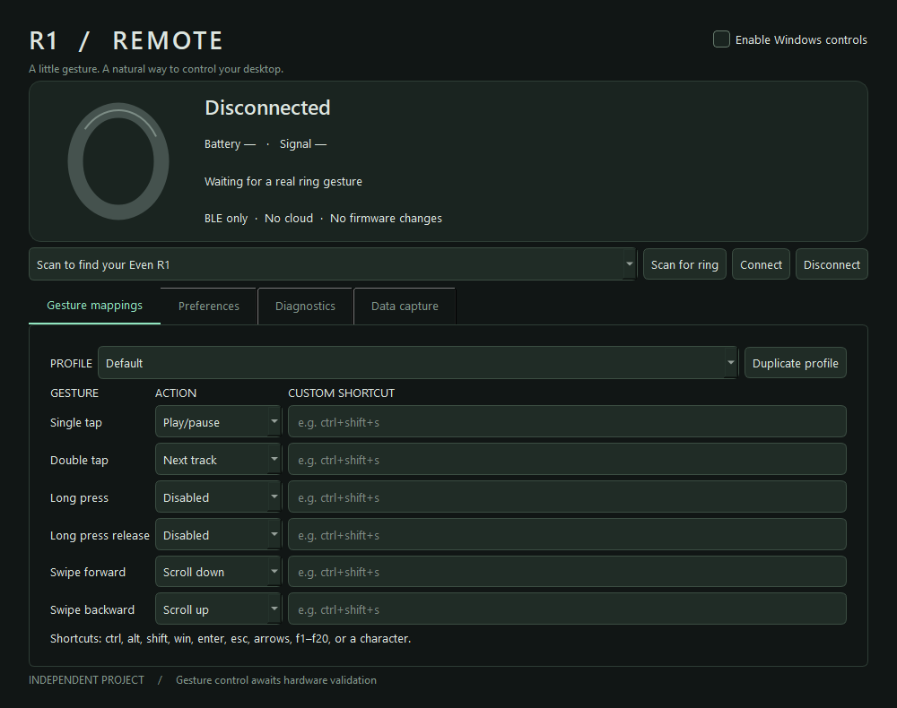

# Even R1 Remote

Independent Windows 11 desktop remote for the Even Realities R1. Direct BLE,
local settings, no G2 dependency, no cloud and no firmware changes.

**Experimental: gesture control is not yet validated on hardware.** Actual R1
discovery, Windows pairing, GATT enumeration and notifications on BAE80011/13
have been observed. The captured notification formats did not match documented
gesture packets, so no hardware gesture-to-action success is claimed. This app
sends no application characteristic writes.

Version 0.1.1 fixes an unresponsive Scan button caused by a Qt worker signal
collision. Diagnostics now reports both all BLE devices seen and R1 matches.
Version 0.1.2 preserves a selected discovered device through connection setup and
keeps available notification channels active if another channel is protected.
Version 0.1.3 adds raw capture sessions with labelled, timed repetitions.



## Install and connect

Download the portable Windows x64 exe from Releases, or the
EvenR1Remote-Windows-x64 artifact from a successful Actions run. Extract archives
and run EvenR1Remote.exe. Python is not needed. This initial build is unsigned.

1. Enable Windows Bluetooth, wake/charge the ring, and release other central
   connections (phone, glasses or another application).
2. Scan, select your advertised Even R1 and connect.
3. Keep Windows controls paused. Open Diagnostics and perform every gesture.
   Check actual notification bytes and decoded events before enabling controls.
4. Choose a profile, configure mappings and enable Windows controls. Actions
   affect the foreground application. Pause from the tray or main window.

Follow Windows pairing prompts if presented. Manual pairing is available through
Settings > Bluetooth & devices > Add device. First-time provisioning and fresh
ring compatibility are unverified. The official app is not required at runtime.
Connected means subscriptions succeeded, not proof of functioning gestures.

## Features

- Two supported notification channels, GATT enumeration, raw packet diagnostics.
- Single/double tap, long press/release, forward/backward swipe.
- Scroll, optional acceleration, volume/media, mouse clicks, custom shortcuts.
- Default, Media, Browser, Presentation and duplicate-to-custom profiles.
- Auto-connect to a saved ring, reconnect backoff, tray pause and minimize.
- Optional current-user Windows startup registration; controls start paused.
- Standard battery reads when available. RSSI is explicitly the last scan value.

## Record data for gesture research

Open **Data capture** after connecting the ring. Press **Start recording** to
create a new local JSONL file. Windows controls are paused and disabled while
recording. The displayed path is saved immediately; every record is flushed to
disk, independently of the short live preview.

Select an action, leave the default five repetitions, and press **Run selected
action**. Remain still during the initial five-second baseline. Each repetition
has a three-second countdown, a five-second action window, and three seconds of
rest. Perform the selected gesture **once** during each **DO ONCE** window. Then
select another action and run its series in the same recording. Custom action
labels and optional manual markers are supported. A disconnect cancels the
current series; logging continues through reconnects until **Stop & save**.

Captures live in `%LOCALAPPDATA%\EvenR1Remote\captures`. **Open capture folder**
opens that location. Session files contain exact notification hex, length,
characteristic UUID, optional handle, connection/sequence identifiers, UTC time
and a monotonic clock timestamp. Duplicates and unknown packets are retained
before decoding or debounce. Trial boundaries carry the intended action label,
repetition and trial ID. Notifications are attributed using their source timestamp,
even when UI delivery is delayed. Labels do not establish a packet's meaning.

Files stay on this PC and are not uploaded. Recording does not query health data
or send initialization commands; it records notifications the ring sends.

## Development and packaging

```powershell
py -3.12 -m venv .venv
.venv\Scripts\Activate.ps1
python -m pip install -r requirements-lock.txt
python -m pip install --no-deps -e .
python -m even_r1
python -m pytest -q
python tests/ui_smoke.py
```

Read-only diagnostics, with no Windows input simulation:

```powershell
python -m even_r1.diagnostics
python -m even_r1.diagnostics --address AA:BB:CC:DD:EE:FF --seconds 60
python -m even_r1.diagnostics --address AA:BB:CC:DD:EE:FF --seconds 60 --record --label "single tap"
```

Build a portable exe:

```powershell
python -m PyInstaller --noconfirm --clean --onefile --windowed --name EvenR1Remote --collect-submodules bleak.backends.winrt --collect-submodules pynput --copy-metadata bleak --add-data "LICENSE;." launch.py
```

Output: dist/EvenR1Remote.exe. Actions tests and builds with Python 3.12 on Windows.
ble.py owns transport, protocol.py pure decoding, actions.py input/debounce,
settings.py profiles/persistence, startup.py Run registration and ui.py Qt UI.

## Troubleshooting

- Bluetooth powered off: enable the radio and retry scanning. Wake the ring,
  move closer and disconnect competing applications if no advertisement appears.
- Connected but silent: export Diagnostics. Initialization remains unverified;
  do not send arbitrary commands. No speculative initialization feature exists.
- A notification channel requires authentication: pair the selected R1 in Windows
  Bluetooth settings. In the observed test, standard Windows pairing enabled
  access to BAE80013. Available channels stay active if another subscription fails.
- Battery unavailable: standard 2A19 may be absent. Proprietary health is not queried.
- Swipe direction: swap mappings if desired; charger up maps to backward and
  down to forward to preserve Hermes event semantics.
- Rapid duplicate actions: adjust debounce. Charger gesture/tick pairs are
  suppressed within the current session.
- Input does nothing: check controls enabled, selected profile and foreground
  window. Windows privilege boundaries can prevent input into elevated apps.
- Close hides the app: reopen from the tray; choose Quit to disconnect and exit.
- Startup needs the registered exe/source environment to stay at its original path.

Settings and rotating logs live in `%LOCALAPPDATA%\EvenR1Remote`. Logs include
device identifiers and raw notification bytes. Unsolicited packets might include
data beyond gestures; health values are never requested, parsed or uploaded.
Review exports before sharing. Disable startup, quit and remove that folder to reset.

See [research and hardware checks](docs/RESEARCH.md), [license](LICENSE), and
[third-party attribution](THIRD_PARTY.md). Unaffiliated with Even Realities.
